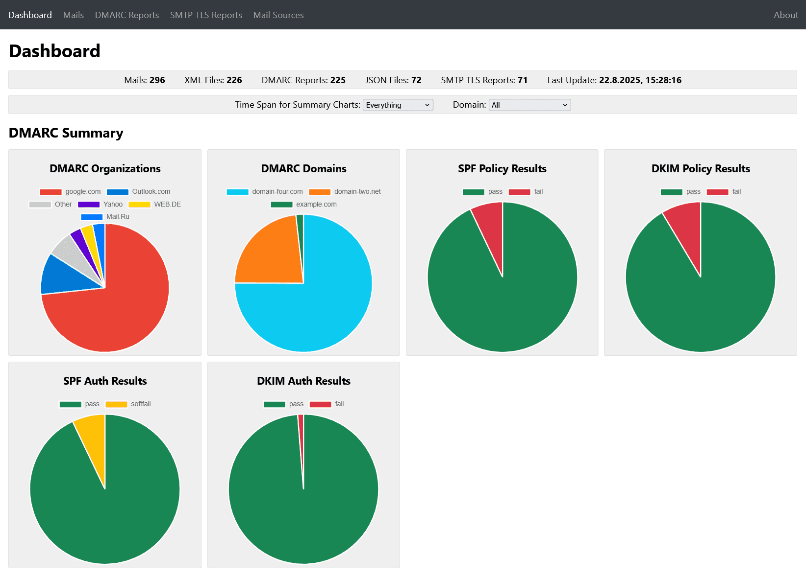

# DMARC Report Viewer

A lightweight, standalone [DMARC](https://en.wikipedia.org/wiki/DMARC#Aggregate_reports) and [SMTP TLS](https://en.wikipedia.org/wiki/Simple_Mail_Transfer_Protocol#SMTP_TLS_Reporting) report viewer.
Ideal for smaller self-hosted mail servers, to browse, visualize, and analyze the reports.

The application is a single fully statically linked executable written in Rust.
It combines a report parser with an IMAP client and an HTTP server.
The embedded HTTP server offers a web UI for easy access and filtering of the reports.

You can run the precompiled executable directly on any Linux, Windows, or macOS system.
Alternatively, you can use the tiny 10 MB Docker image to deploy the application.
It is also easy to [build the application](#build-from-source) directly from source.

You can find more screenshots [here](screenshots/screenshots.md).

## Features
- [x] Lightweight Docker image for easy deployment
- [x] Prebuilt binaries and Docker images
- [x] Runs out of the box on a Raspberry Pi
- [x] Secure IMAP client (TLS & STARTTLS)
- [x] Robust parsing of XML DMARC reports
- [x] Robust parsing of JSON SMTP TLS reports
- [x] Filters all report types for duplicates
- [x] Embedded HTTP server for Web UI
- [x] Responsive Web UI that also works on small screens
- [x] Automatic fetching of reports from IMAP inbox
- [x] Updates are scheduled via a simple update interval or cron expression
- [x] Automatic HTTPS via ACME/Let's Encrypt
- [x] Basic Auth password protection for HTTP server
- [x] Easy configuration via command line arguments or ENV variables
- [x] Configurable maximum size of mails (to skip oversized mails)
- [x] Summary with charts for domains, organizations and passed/failed checks
- [x] Filter chart summaries by domain or time span
- [x] Viewing of ranked sources/IPs by domain and report type
- [x] Viewing filtered lists of reports
- [x] Viewing of individual reports
- [x] Export reports as XML or JSON documents
- [x] List all emails in the IMAP inbox
- [x] Viewing of individual mail metadata with a list of extracted reports
- [x] Show parsing errors for reports
- [x] Lookup of DNS, location, whois and other source IP properties
- [x] Webhook to notify external services about new emails
- [x] HTTP Health Check Endpoint and Docker Health Check integration

## Changelog
Read the [CHANGELOG.md](CHANGELOG.md) file for a list of all released versions and their corresponding changes.

## Run with Docker
The latest versions are automatically published as Docker images in the GitHub container registry.
You can download the latest release using the command `sudo docker pull ghcr.io/cry-inc/dmarc-report-viewer`.
Alternatively, you can also pull from Docker Hub: `sudo docker pull cryinc/dmarc-report-viewer`.

### Available Docker Tags
The following tags are available (aside from the versioned tag for all individual releases):
* `latest` (Latest stable release)
* `develop` (Last development build from master branch)

## Configuration
List all available configuration parameters with the corresponding environment variables and default values by running this command:
`sudo docker run --rm ghcr.io/cry-inc/dmarc-report-viewer ./dmarc-report-viewer --help`.

You can configure the application with command line arguments or environment variables.
For the Docker use case, environment variables are recommended.
Do not forget to forward the port for the HTTP server!
By default the HTTP server will use port 8080.

Here is an example: 

    sudo docker run --rm \
      -e IMAP_HOST=imap.mymailserver.com \
      -e IMAP_USER=dmarc@mymailserver.com \
      -e IMAP_PASSWORD=mysecurepassword \
      -e HTTP_SERVER_USER=webui-user \
      -e HTTP_SERVER_PASSWORD=webui-password \
      -p 8080:8080 \
      ghcr.io/cry-inc/dmarc-report-viewer

### Application Data
This application does not store any reports in a database or in any other kind of file.
All data is kept in memory and fetched fresh each time from the configured IMAP account.
The only exception is the certificate cache folder when using Let's Encrypt;
this folder should be persisted between application restarts.

### IMAP Folders
By default, a single `INBOX` folder is used to look for all supported report types.
You can change this to any other folder by specifying the ENV variable `IMAP_FOLDER`.
To enable the search of one or more levels of sub-folders, use the setting `IMAP_FOLDER_DEPTH`.

It is also possible to specify a dedicated IMAP folder for each report type.
Use the environment variables `IMAP_FOLDER_DMARC` or `IMAP_FOLDER_TLS` to do so.
Warning: As soon as you set one of the dedicated folders, the default folder will be ignored!
TLS reports in the DMARC folder, and vice versa, will generate warnings due to unexpected errors.

Please note that fetching reports from different IMAP accounts is currently not supported.
You might have to set up forwarding if you receive reports in separate accounts.

### IMAP with STARTTLS
By default, the IMAP client will attempt to use a TLS-encrypted connection on port 993.
For STARTTLS set the ENV variables `IMAP_STARTTLS=true` and `IMAP_PORT=143`.

### HTTPS for UI
By default, the application starts an unencrypted and insecure HTTP server.
It is *strongly* recommended that you use the automatic HTTPS feature, which automatically fetches and renews a certificate from Let's Encrypt.
This feature uses the TLS-ALPN-01 challenge, which also uses HTTPS port 443. No port 80 is required!
Alternatively, you can use a separate HTTPS reverse proxy like [Caddy](https://caddyserver.com/) to secure the application.
The application also works when served via a reverse proxy in a non-root folder!

To use the included HTTPS feature, make sure that the public port exposed to the internet is 443.
You should also persist the certificate caching directory on your host file system:

    sudo docker run --rm \
      -e IMAP_HOST=imap.mymailserver.com \
      -e IMAP_USER=dmarc@mymailserver.com \
      -e IMAP_PASSWORD=mysecurepassword \
      -e HTTP_SERVER_PORT=8443 \
      -e HTTP_SERVER_USER=webui-user \
      -e HTTP_SERVER_PASSWORD=webui-password \
      -e HTTPS_AUTO_CERT=true \
      -e HTTPS_AUTO_CERT_CACHE=/certs \
      -e HTTPS_AUTO_CERT_MAIL=admin@mymailserver.com \
      -e HTTPS_AUTO_CERT_DOMAIN=dmarc.mymailserver.com \
      -v /host/cert/folder:/certs \
      -p 443:8443 \
      ghcr.io/cry-inc/dmarc-report-viewer

### IPv6 Support
By default the HTTP server will bind to any IPv4 address of the machine.
This is because the default bind setting is `0.0.0.0`.
You can use the configuration option `--http-server-binding [::]` or ENV variable `HTTP_SERVER_BINDING=[::]` for IPv6.
Note that on Linux, this will bind to both IPv4 and IPv6 by default.

### Disable Basic HTTP Auth
By default, the application requires you to set a password to secure access via basic HTTP authentication.
If you want to use other access controls (e.g. via a reverse proxy),
you can disable basic authentication by setting an empty string as the password.

### DNS Server
The app uses a lightweight asynchronous DNS client to look up hostnames for IP addresses.
Currently, this requires configuring a DNS server.
By default, the free public DNS server 1.1.1.1 is used.
When looking up many IP addresses on the mail sources UI page, using another DNS server can greatly speed up the process.
For example, you can use the DNS server from your own provider or data center.
The closer the DNS server is to the machine running the app, the faster it will be.
You can use the ENV var `DNS_SERVER="<IP of DNS server>:53"` to set a custom DNS server.

### Health Checks
The service provides a health check endpoint at `/health` that always returns an empty HTTP 200 OK response.
The Docker image also contains a HEALTHCHECK statement, allowing containers to check themselves.
The health check works by executing the binary in a special mode with the `--health-check` argument.
It then tries to get the HTTP/HTTPS configuration from the environment variables and build a URL to query the health check endpoint.
If you have an exotic network setup this might fail and you need to override or disable the health check.
Feel free to create an issue in this case!

### Microsoft 365 / Entra ID / Exchange
Microsoft does not allow simple password-based authentication.
If you receive your DMARC or SMTP TLS reports via a Microsoft email address,
you will not be able to use this tool directly, since it only supports password-based authentication.

However, you can use other software like [DavMail](https://davmail.sourceforge.net/) to create
a local IMAP proxy that takes care of authentication and provides IMAP access with a password.
You can find more information and an example configuration [here](ms-365/README.md).

## Build from Source
1. Install the Rust toolchain (see https://rustup.rs/)
2. Check out this repository (or download and extract the ZIP file)
3. Run the command `cargo build --release` in the folder with this README file
4. Find the compiled executable in the folder `target/release`
5. Use the help argument to list all possible configuration parameters: `dmarc-report-viewer --help`

### Docker Builds (Linux only)
The Dockerfile works for `amd64` and `arm64` architectures.
1. Install Docker
2. Check out this repository (or download and extract the ZIP file)
3. Run the command `sudo docker build . --pull --tag dmarc-report-viewer` in the folder with this README file
4. You should now be able to see the new Docker image using the command `sudo docker images`

## Development Setup
You only need git and the Rust toolchain to work on this project.
No JavaScript tooling like Node, NPM or a bundler is required for the UI.
The UI code has all dependencies included and does not need any build steps.

When running debug builds, the UI files can be reloaded from your checkout.
This means you can iterate on the UI without rebuilding the Rust backend every time!
This does not work for release builds, where the UI loads the files directly from the binary.

## Contributing
Please avoid creating unannounced feature PRs, even when there is already a corresponding open issue.
I want to keep the scope of the app as small as possible.
Additionally, it takes real work to review and audit PRs to keep the app stable, robust, and secure.
It is now easy to create huge PRs in minutes, and in this asymmetric world I prefer to
not spend my spare time with reviews of LLM-generated code.

Please do the following before you create a PR:
* Format the code (run `cargo fmt`).
* Run Clippy for linting (run `cargo clippy --all --all-targets --all-features`).
* Execute the included test suite (run `cargo test`).

The PR validation pipeline will also run these commands and fail if there are any issues.

## Acknowledgments
- Thanks to all the Rust dependencies in [Cargo.toml](Cargo.toml) that make this application possible!
- Thanks to the JavaScript libraries [Chart.js](https://github.com/chartjs/Chart.js) and [Lit](https://lit.dev/), which are used for the UI.
- Thanks to [@bbustin](https://github.com/bbustin) for his [dmarc_aggregate_parser](https://github.com/bbustin/dmarc_aggregate_parser) that was used as the starting point for the DMARC report parser.
- Thanks to [@marvinruder](https://github.com/marvinruder) for implementing SMTP TLS support!
